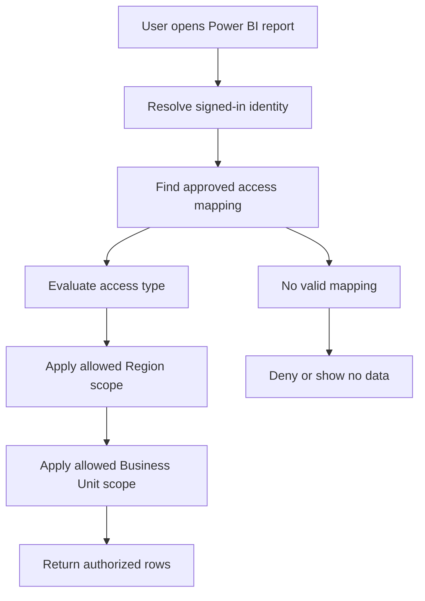

# Power BI Access Control — Email, Region and Business Unit

## 1. Objective

Provide users access to the CRM reporting data appropriate to their identity and approved organizational scope. The portfolio design uses an access mapping concept based on user email, Region and Business Unit.

## 2. Conceptual access mapping

| User email | Access type | Region | Business Unit |
|---|---|---|---|
| user1@example.com | Region | North | - |
| user2@example.com | Region, BU | South | Consulting |
| user3@example.com | Region, BU | West | Research |
| user4@example.com | All | - | - |

All values above are synthetic examples. In this template, `-` is a placeholder meaning broader scope only if that interpretation is explicitly implemented and approved in the actual access rules. Do not treat a hyphen as a universal security convention without validating the model logic.

## 3. Conceptual evaluation flow

## 4. Implementation considerations

- Use the authenticated identity available to the semantic model, not a user-entered email field.
- Store access mappings in a governed table with controlled maintenance.
- Enforce data filtering in the semantic model or another approved security layer.
- If using dynamic Row-Level Security (RLS), test the role expression and relationship propagation carefully.
- Distinguish report/app access from row-level data access. Hiding a page or visual is not a substitute for data security.
- Test users with one region, multiple regions, one business unit, multiple business units, broader access and no mapping.
- Validate access across all relevant semantic models and reports, not only one dashboard.
- Confirm that exports, subscriptions, PDF attachments and shared links do not bypass the intended security scope.

## 5. Security test matrix

| Test case | Expected result |
|---|---|
| User mapped to one region | Only authorized region rows |
| User mapped to region + BU | Only authorized region and BU intersection |
| User mapped to multiple allowed scopes | Only the approved union/intersection per documented rule |
| User with broader approved scope | Broader data only as explicitly authorized |
| User absent from mapping | Deny access or return no rows |
| User changes report filters | Filters cannot expand beyond security scope |

## 6. Documentation to complete

Record the actual Power BI role names, DAX expressions, mapping table schema, relationship paths, identity function, workspace/app permissions and test evidence before publishing implementation-specific claims.
