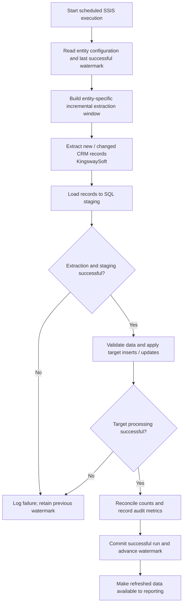

# Solution Architecture

## 1. Architecture summary

The integration moves CRM data from Microsoft Dynamics 365 into an on-premises SQL Server platform. SSIS orchestrates the workflow and KingswaySoft provides CRM connectivity and data movement. A metadata-driven or consistently parameterized approach can be used to manage entity-specific extraction settings; the precise implementation should match the actual SSIS packages.

## 2. Logical layers

| Layer | Responsibility | Typical contents |
|---|---|---|
| Source | Operational CRM data | Accounts, Contacts, Opportunities and other approved entities |
| Extraction | Retrieve new and changed records | SSIS control flow, KingswaySoft source components, entity filters |
| Staging | Land extracted records before target processing | Staging tables, batch/run identifiers, load timestamps |
| Transformation | Validate and apply changes | T-SQL procedures, data type handling, business rules |
| Target | Persist integrated CRM data | Entity target tables and reporting views |
| Consumption | Enable analytics | Power BI datasets, reports and downstream queries |
| Control/audit | Track load state and outcomes | Watermarks, execution status, counts, error logs |

## 3. End-to-end flow



## 4. Incremental extraction model

An incremental load identifies records that are new or modified since a previously completed run. A common pattern uses a source-side modification timestamp or a platform-supported change-tracking mechanism.

Illustrative logic:

```text
previous_watermark = last successful watermark for the entity
window_start       = previous_watermark - configured_overlap
window_end         = extraction start time

extract records changed within [window_start, window_end]
stage extracted records
validate and apply changes to target
if all required steps succeed:
    save window_end as the new watermark
else:
    retain previous_watermark
```

The overlap is a configurable safety measure for timestamp precision, delayed visibility or retry scenarios. It must be paired with idempotent target processing to avoid duplicates. Do not claim this exact overlap pattern unless it matches the implemented package.

## 5. Entity-level orchestration

Each entity may have different source attributes, filters, relationships, volume and target mapping. Maintain an inventory with at least:

- CRM entity logical name
- Destination table
- Incremental field or mechanism
- Primary key / CRM identifier
- Extraction filter
- Transformation procedure
- Delete-handling approach
- Last tested date and owner

Use `docs/entity-inventory-template.csv` to document the approved entity list.

## 6. Failure and restart principles

- A failed extraction or target load must not advance the successful watermark.
- A retry should safely reprocess the same extraction window.
- Target writes should be idempotent, typically by matching on a stable source identifier.
- Log errors with entity name, run ID, package/task, timestamp and a safe diagnostic message.
- Keep secrets out of package source files and Git history.
