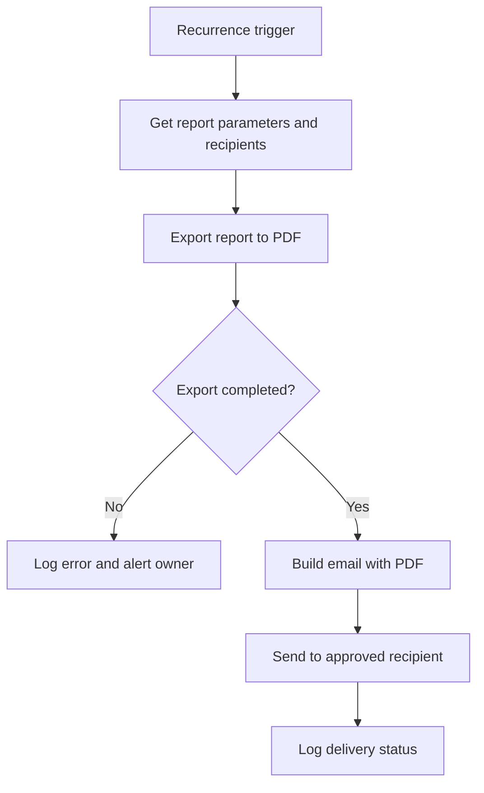

# Automated Power BI PDF Report Distribution

## Objective

Document a controlled process for exporting selected Power BI reports to PDF and distributing them to approved recipients using Power Automate.

## High-level workflow

1. Trigger the flow on an approved schedule.
2. Identify the report, workspace and reporting period.
3. Resolve the intended recipient list from an approved source.
4. Export the report to PDF using a supported Power BI action/API.
5. Check export status and handle failures.
6. Prepare the email subject and body.
7. Attach or embed the PDF using the supported action and encoding.
8. Send only to authorized recipients.
9. Record the export and delivery outcome.

## Design and security considerations

- Confirm workspace capacity and licensing prerequisites for PDF export.
- Use a service identity with least privilege.
- Keep recipient lists in a governed location.
- Ensure report filters and security context are appropriate for each recipient.
- Do not assume an email attachment automatically inherits Power BI row-level security.
- Avoid sending a single broadly filtered PDF to users with different data permissions.
- Log failures without storing sensitive report content in diagnostic messages.
- Test file size, page layout, export timing and delivery.

## Example flow outline

This is a design document, not an exported Power Automate flow package. Configure connector actions and permissions in the target tenant.
