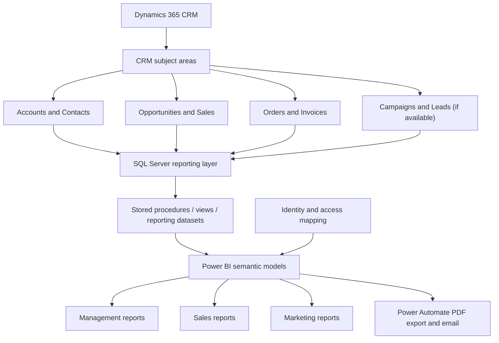
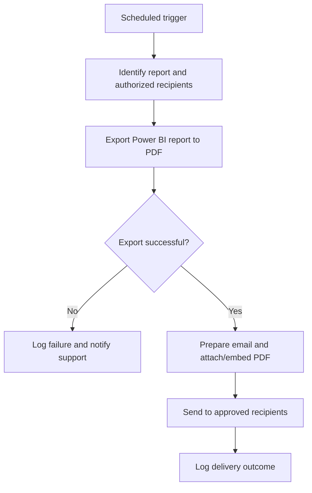

# CRM Power BI — Solution Architecture

## 1. Logical architecture

## 2. Architecture layers

| Layer | Purpose | Typical artifacts |
|---|---|---|
| CRM source | Operational business data | Accounts, Contacts, Opportunities, Orders, Invoices, Campaigns and Leads |
| SQL reporting | Prepare consistent reporting datasets | Tables, views, stored procedures |
| Semantic model | Relationships, measures and metadata | Power BI semantic models, DAX |
| Report experience | Role-focused analytics | Management, Sales and Marketing reports |
| Security | Restrict data to authorized users | User mapping, role/scope rules, RLS where configured |
| Distribution | Deliver recurring reports | Power Automate flows, PDF exports, recipient configuration |

## 3. Semantic model design

A typical commercial CRM model may include dimensions such as Date, Account, Employee/Salesperson, Region, Business Unit, Campaign and Opportunity Stage, with facts such as Opportunity, Invoice, Sales Order and Campaign Activity. The actual model should follow available source data and grain.

Document for each model:
- Business purpose and report consumers.
- Fact table grain and key dimensions.
- Relationship cardinality and filter direction.
- Measures and KPI definitions.
- Storage mode (Import, DirectQuery, Direct Lake or composite, as actually configured).
- Refresh or query behavior and performance considerations.

## 4. Report distribution flow

The export API, workspace capacity, licensing and connector capabilities must be validated for the tenant. Do not distribute a report to recipients whose access scope has not been verified.
