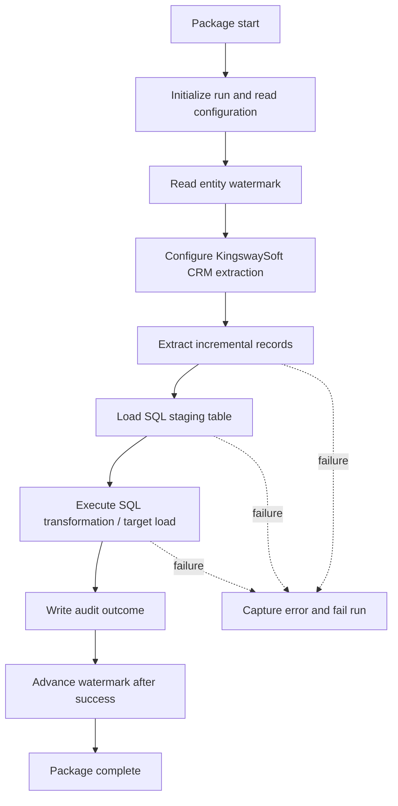

# SSIS and KingswaySoft Package Design

## Objective

Provide a consistent, supportable SSIS pattern for extracting multiple Dynamics 365 CRM entities and loading them into SQL Server incrementally.

## Logical package flow

## Suggested package responsibilities

| Component | Responsibility |
|---|---|
| Control Flow | Orchestrate tasks, precedence constraints and failure paths |
| Configuration | Supply entity, source, target and execution settings |
| KingswaySoft source | Connect to Dynamics 365 and retrieve the configured entity data |
| Data Flow | Transfer source rows to SQL Server staging |
| Staging destination | Persist the extracted batch |
| Execute SQL Task | Run validation and target-processing procedures |
| Logging | Capture package/task status and row counts |
| Watermark update | Persist the next watermark only after successful processing |

## Reusability

For a multi-entity integration, consider standardizing package conventions while retaining entity-specific mappings and rules. Reuse should not obscure differences in CRM schema, relationships, volume or business logic.

## Deployment and security

- Keep connection strings and credentials in secure environment-specific configuration.
- Do not commit passwords, access tokens, tenant secrets or exported production configurations.
- Separate development, test and production settings.
- Use least-privilege service identities.
- Document package version, dependencies and deployment procedure without exposing internal infrastructure.
